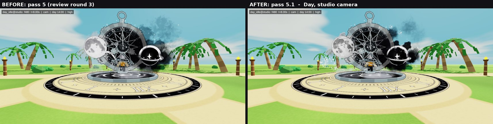
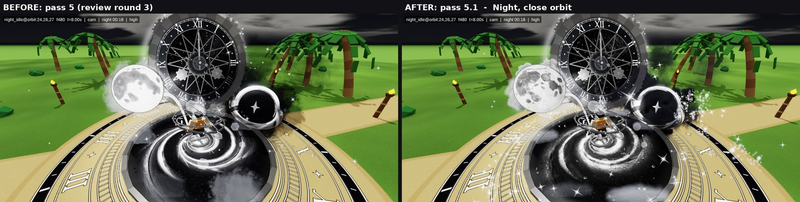
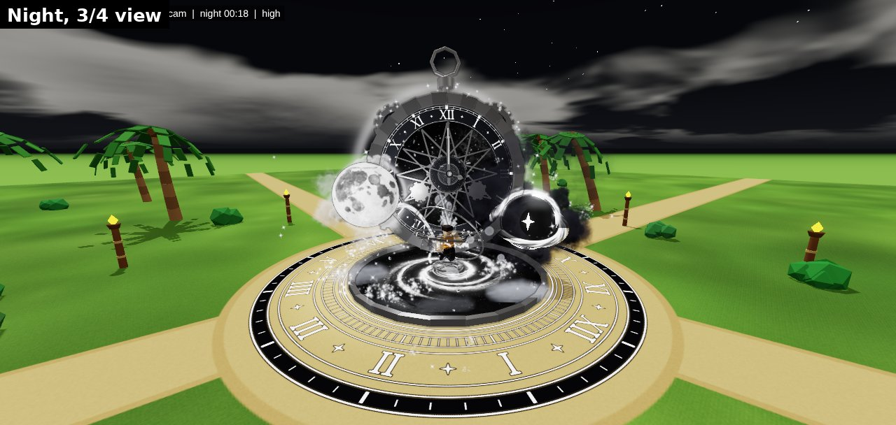
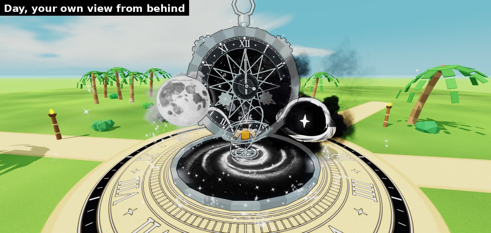
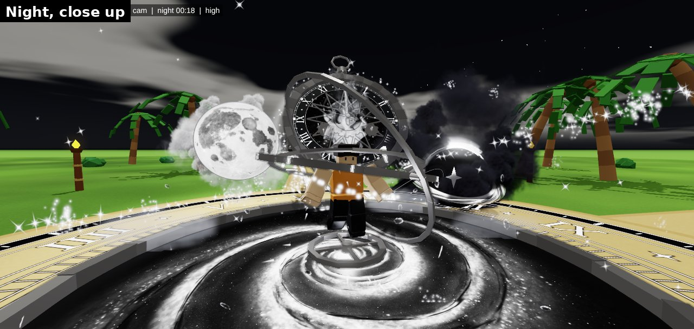

# THE END, pass 5.1: "The Last Clock"

This is the new **equipped** aura for 『 THE END 』 (1 in 1,000,000,000), the one you wear after you roll it. The roll
cutscene is not changed.

## What it is

A huge black-and-silver pocket watch, about 28 studs across, stands behind you and always turns to face whoever is looking.
Its hands are locked at XII (midnight, the end) while the seconds hand sweeps on. It keeps the clock, like you asked. On
one side is a moon that looks like a real photograph of the Moon. On the other is a black void with a white star for a
heart, a swirling disc of light and thick black smoke rolling off it. Silver rings spin round your body, and a silver and
an ink ribbon braid up round you. You float over a real-looking spiral galaxy, and a 56-stud engraved clock stage lies on
the ground. A ring of twinkling stars and glitter orbits the whole aura, stars twinkle inside the clock face, sparks spray
where metal shards break off the clock and fly into the void, and burning ember flakes rise off the floor. When you equip
it, the watch builds itself piece by piece in about 6.5 seconds.

It uses only black, white and silver. Everything solid is solid, not see-through, and there are no flashes or flicker.
It's made to read on the bright cyan day sky and at night, and to follow your character when you walk, jump, fly, glide
and sit.

## What pass 5.1 changed (you said: "improve the particle effects and texture tenfold")

- **Every texture was remade at film quality**, by computer programs that render real light:
  - **Smoke:** real 3D smoke with light and shadow. It billows out in rolling lobes and thins into curling veils, instead
    of a flat blob.
  - **Moon:** a rendered globe with the real Moon's dark seas, about 26,000 craters and bright rays from Tycho and
    Copernicus.
  - **Galaxy:** a spiral galaxy with star clouds, bright knots and dark dust lanes.
  - **Void disc:** the swirling disc round the void is torn, glowing gas, like the black hole in *Interstellar*.
  - **Clock face:** the star window in the clock face is a Milky Way band.
  - **Particles:**
    - **Shards:** ray-traced pieces of polished steel that tumble.
    - **Embers:** ember flakes that burn at the edges.
    - **Stars:** photographic star twinkles.
    - **Glitter:** clusters whose grains sparkle on their own.
    - **Streaks:** comets and sparks.
- **New particle effects:** a star halo ring round the whole aura, the silver and ink double helix round your body, stars
  twinkling inside the clock face and sparks where the shards break off.

## Pictures

These come from our **cloud preview tool**, not from Roblox. Roblox's lighting and glow will make it look a bit different.
They show the new textures, which still need uploading. Until they are uploaded, the aura uses older pass-4 textures.

**1. Before and after, day, from the camera you used for your pass-4 screenshots**

**2. Before and after, night, close up**

**3. Night, from the front corner**

**4. What you see while playing (camera behind you)**

**5. Close up at night**

All ten pictures are in [`pass51-renders/`](pass51-renders/). The textures' own before/after sheets are
`textures/te5/particles/sheets/before_after.png`, `textures/te5/smoke/sheets/before_after.png` and
`textures/te5/surfaces/sheets/before_after.png`. Pass 5's pictures are still in [`pass5-renders/`](pass5-renders/).

## Where it stands (honest)

- **It's built, and it has been tested in the cloud only.** The cloud can't open Roblox Studio. So the code ran against a
  pretend version of Roblox in 35 test situations: day, night, flying, jumping, sitting, six players, respawning and more.
  It had no errors, and the code checker found nothing wrong. The preview tool drew the pictures above.
- **Nothing has run in real Roblox yet.** The first real test is on your Mac. Some things can only be checked there, like
  how the glow looks, which way some textures face and how fast it runs on your computer.

## How to install it

Easiest way: open [`roblox/install/MILO_PROMPT.md`](../../roblox/install/MILO_PROMPT.md), copy the message in the box and paste
it into Claude Code on your Mac (with Studio open and the Studio MCP connected). It does the install, the tests and the
screenshots, and shows you everything.

The full steps, including doing it by hand, are in [`roblox/install/README.md`](../../roblox/install/README.md). Your current
pass-4 aura is backed up first, so nothing gets lost.

## What's still to do

1. **Install and test with the pass-4 textures first**, so we know the code runs in Studio.
2. **Upload the 23 new textures** (moon first) from your Mac. See
   [`roblox/install/upload_textures.md`](../../roblox/install/upload_textures.md). Then install again. That's when the
   pictures above come true.
3. **Check the STUDIO-VERIFY items:** things only Studio can answer. The checklist is
   [`roblox/install/studio_checks.md`](../../roblox/install/studio_checks.md), and the full list is in the build notes.
4. **Your choices:**
   - the **far beacon** (a thin, steady spire over a wearer that only shows from far away: on or off);
   - **`FRAME_TOP`** (just the dial and XII in view, or the whole watch);
   - the silver: it's now neutral, a tiny bit warm, because the sunny sky tints metal cyan. Do you like it?
5. Then on to the other auras. You wanted *all* the VFX tenfold better.

## If something goes wrong: roll back

Run `roblox/install/payloads/99_rollback.luau` in Studio (Edit mode). It puts your pass-4 aura back exactly as it was, and
saves the new version first, so you can try again later. See step 5 of
[`roblox/install/README.md`](../../roblox/install/README.md).

## More detail

- [`pass5-spec.md`](pass5-spec.md): the full design (every part, size and number)
- [`pass5-build-notes.md`](pass5-build-notes.md): what was built, every review round, pass 5.1 and the STUDIO-VERIFY list
- [`pass5-art-direction.md`](pass5-art-direction.md): the art director's "Last Clock" idea it all started from
- [`../../tools/README.md`](../../tools/README.md): the cloud test tools
