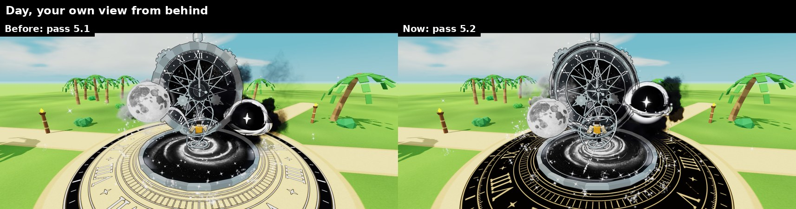
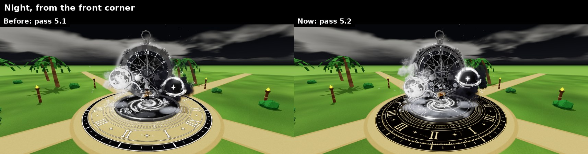
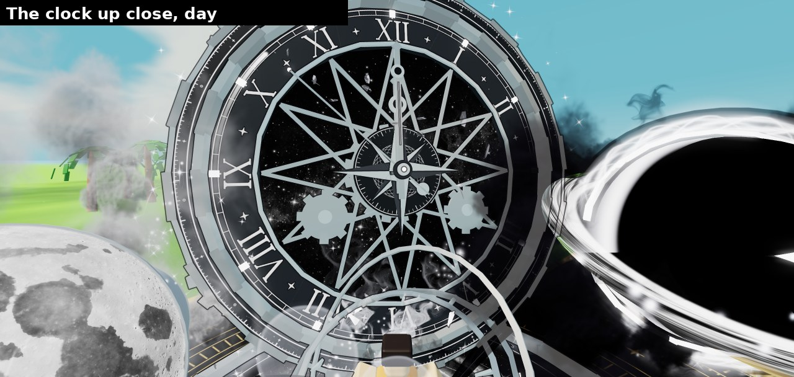
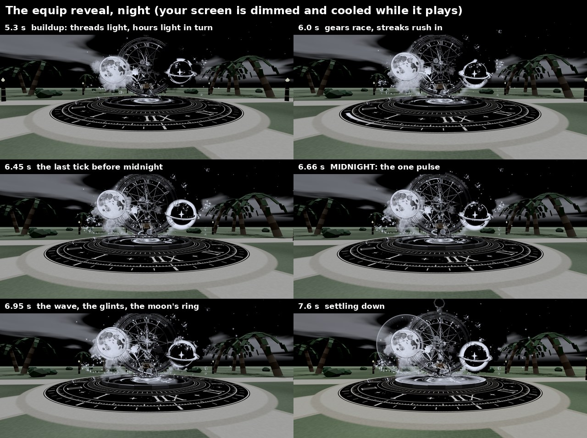
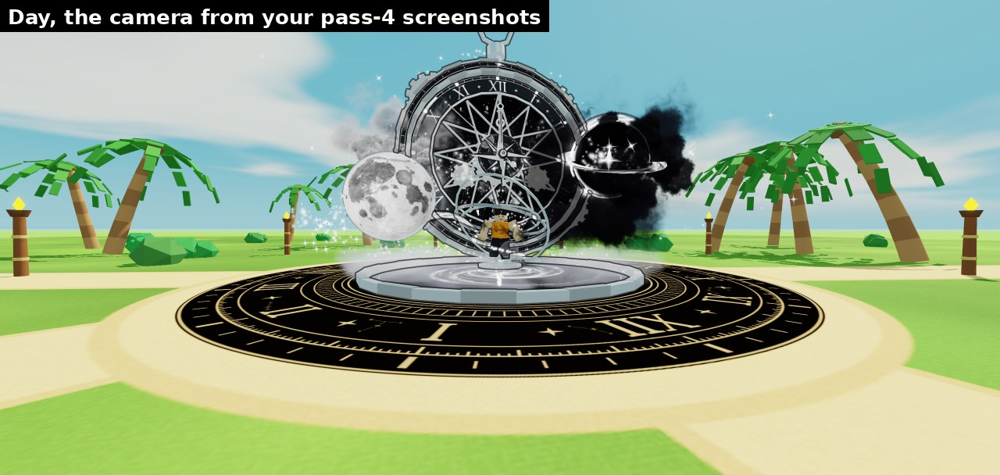

# THE END, pass 5.2: "The Last Clock"

This is the new **equipped** aura for 『 THE END 』 (1 in 1,000,000,000), the one you wear after you roll it. The roll
cutscene is not changed.

## What it is

A huge black-and-silver pocket watch, about 28 studs across, stands behind you and always turns to face whoever is looking.
On one side is a moon that looks like a real photograph of the Moon. On the other is a black void with a white star for a
heart, a swirling disc of light and thick black smoke rolling off it. Silver rings spin round your body, and you float
over a black-and-white spiral galaxy on a gold-and-black clock platform 56 studs across. Threads of energy join the moon,
the clock, the void and the floor.

It uses black, white and silver, plus the gold on the platform you asked to keep. Everything solid is solid, not
see-through. It's made to read on the bright cyan day sky and at night, and to follow your character when you walk, jump,
fly, glide and sit.

## What pass 5.2 changed

You said: *"Do not change the concept. Upgrade its execution."* So everything you listed is still there:

- the silver clock with its Roman numerals, gears and central star;
- the moon on the left;
- the black void with its white star and dark smoke;
- the white sparkles and fragments;
- the black-and-white galaxy under you;
- the gold-and-black platform;
- you in the middle.

What changed is how they're made and how they move.

### 1. The clock (your first priority)

- **A dark engraved band in the bezel.** A near-black band now sits in the silver bezel, with bright silver edges on both
  sides. It's engraved with a fine degree scale and little stars, and it creeps round slowly, like the night sky.
- **A polished ring** frames the star window in the middle of the dial.
- **A real central star.** The centre has an eight-point star cut like a gem, bright silver on one side of each point and
  dark gunmetal on the other. The little dial under it turns slowly while the star stays still.
- **Breguet "moon" hands.** The hour and minute hands each have a polished ring near the tip, like a fancy watch.
- **A comet of light on the seconds hand.** It sweeps round the dial with the hand and lights each hour as it passes.
- **Things that move, and things that stay still.** The engraved band, the little dial, the gears and the seconds hand
  turn. The frame, the numbers and the star stay still, so the movement is easy to read.

### 2. Energy between the parts (your second priority)

- **Three thin threads of energy**, each with soft pearls of light gliding along it:
  - from the moon into the clock at IX;
  - out of the clock at III into the void, where the light turns dark as the void swallows it;
  - from VI down to the galaxy on the floor.
- **Moonlight drifts** down the moon's thread into the clock.
- **A bright segment of light** runs round two of the rings around you.

### 3. The galaxy and the particles (your third priority)

- **The floor is built in layers**, each turning its own way at its own speed:
  - the broad, slow galaxy;
  - rings of energy with a bright outer edge;
  - the galaxy's arms;
  - a fine, fast swirl;
  - the bright centre.
- **Specks of light stream in** toward you along two spiral arms.
- **Every particle has a job**, and the big ones only happen at the right moment (see the reveal below).

### 4. The reveal when you equip it: a buildup, one big moment, then calm

1. The watch builds itself, and the hands spin in to **five to midnight**.
2. **The buildup:**
   - the threads of energy light up one after another;
   - a sweep of light goes round the dial, and the hour markers light up one by one;
   - the gears speed up, and the void's smoke pulls in tight;
   - the moon and the centre of the galaxy get brighter;
   - a golden light sweeps round the platform;
   - streaks of light rush into the clock.
3. The minute hand **ticks to XII**, one minute at a time.
4. **Midnight, on the fifth tick.** The gears stop dead for a moment and one soft pulse goes out:
   - a ring of light off the moon;
   - a wave across the whole floor;
   - glints bursting off the dial, which slow down and stay orbiting it;
   - sparks lifting off the floor;
   - the void's smoke blown outward.
5. Then everything **settles into a calmer idle**.

On your screen only, the picture glows a little at midnight and the camera pushes in slightly. After the reveal it all
goes back exactly how it was. Nobody else's screen or lighting changes.

That pulse at midnight is the only flash. While you're just wearing it, nothing pulses or flickers.

### 5. The moon, the void and the platform

- **The moon:**
  - a soft glow round it (a pale haze by day);
  - a ring of tiny stars orbiting it;
  - it slowly rocks a little, the way the real Moon does.
- **The void:**
  - its bright rim is thicker and whiter on the side facing the clock, like a real black hole;
  - its white star has a soft glow with rays;
  - thin ink tendrils curl between the smoke clouds, which now have gaps;
  - specks of light spiral into it from every side.
- **The platform:** gold markings on a black base. It doesn't glow at night, so the details stay sharp. It brightens
  once, briefly, at midnight.

## Pictures

These come from our **cloud preview tool**, not from Roblox. Roblox's lighting and glow will make it look a bit different.
They show the new textures, which still need uploading. Until they're uploaded, the aura uses older textures, and a few of
the new layers (the bezel engraving, the comet trail, the floor's swirl and rings) only appear after the upload.

**1. Before and after, from your own view behind you (day)**

**2. Before and after, night, from the front corner**

**3. The clock up close: the engraved band, the polished ring, the cut star, the Breguet hands and the comet of light on
the seconds hand**

**4. The reveal, step by step (your screen is dimmed and cooled while it plays, then comes back)**

**5. Day, from the camera you used for your pass-4 screenshots**

All thirteen pictures are in [`pass52-renders/`](pass52-renders/). The new textures' own sheets are in
`textures/te5/surfaces/sheets/` and `textures/te5/particles/sheets/`. Pass 5.1's pictures are still in
[`pass51-renders/`](pass51-renders/).

## Where it stands (honest)

- **It's built, and it has been tested in the cloud only.** The cloud can't open Roblox Studio. So the code ran against a
  pretend version of Roblox in 35 test situations, including day, night, flying, jumping, sitting, six players and
  respawning. It had no errors, and the code checker found nothing wrong. The preview tool drew the pictures.
- **Nothing has run in real Roblox yet.** The first real test is on your Mac. Some things can only be checked there, like
  how the glow looks, which way some textures face and how fast it runs on your computer.
- **About VFX Studio:** it's a plugin on your Mac, and the cloud can't open Studio or its plugins. So every texture here is
  made by code instead. Once it's installed, you can use VFX Studio on your Mac to tweak anything you like.

## How to install it

Easiest way: open [`roblox/install/MILO_PROMPT.md`](../../roblox/install/MILO_PROMPT.md), copy the message in the box and paste
it into Claude Code on your Mac (with Studio open and the Studio MCP connected). It does the install, the tests and the
screenshots, and shows you everything.

The full steps, including doing it by hand, are in [`roblox/install/README.md`](../../roblox/install/README.md). Your current
aura is backed up first, so nothing gets lost.

## What's still to do

1. **Install and test with the old textures first**, so we know the code runs in Studio.
2. **Upload the 29 new textures** (moon first) from your Mac. See
   [`roblox/install/upload_textures.md`](../../roblox/install/upload_textures.md). Then install again. That's when the
   pictures come true.
3. **Check the STUDIO-VERIFY items:** things only Studio can answer. The checklist is
   [`roblox/install/studio_checks.md`](../../roblox/install/studio_checks.md), and the full list is in the build notes.
4. **Your choices:**
   - the **far beacon** (a thin, steady spire over a wearer that only shows from far away): on or off;
   - **`FRAME_TOP`**: just the dial and XII in view, or the whole watch;
   - the silver: it's neutral, a tiny bit warm, because the sunny sky tints metal cyan. Do you like it?
   - the **camera push-in and the glow at midnight**: keep them, or switch them off (`REVEAL_PUSH`, `REVEAL_BLOOM`);
   - the **energy threads**: keep them, or switch them off (`LINKS`).
5. Then on to the other auras. You wanted *all* the VFX tenfold better.

## If something goes wrong: roll back

Run `roblox/install/payloads/99_rollback.luau` in Studio (Edit mode). It puts your current aura back exactly as it was,
and saves the new version first, so you can try again later. See step 5 of
[`roblox/install/README.md`](../../roblox/install/README.md).

## More detail

- [`pass5-spec.md`](pass5-spec.md): the full design (every part, size and number; §12 has the reveal's timeline)
- [`pass5-build-notes.md`](pass5-build-notes.md): what was built, every review round, pass 5.1, pass 5.2 and the
  STUDIO-VERIFY list
- [`pass5-art-direction.md`](pass5-art-direction.md): the art director's "Last Clock" idea it all started from
- [`../../tools/README.md`](../../tools/README.md): the cloud test tools
