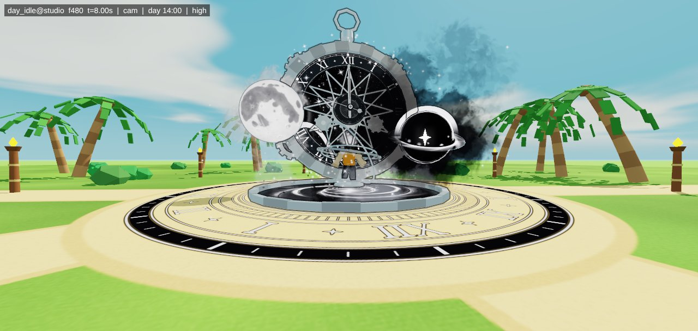
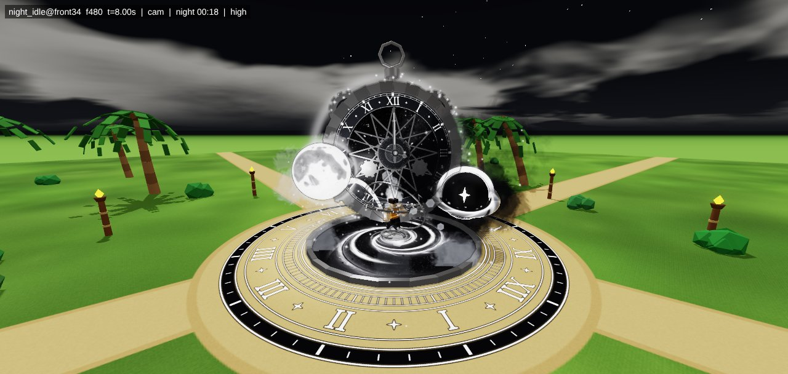
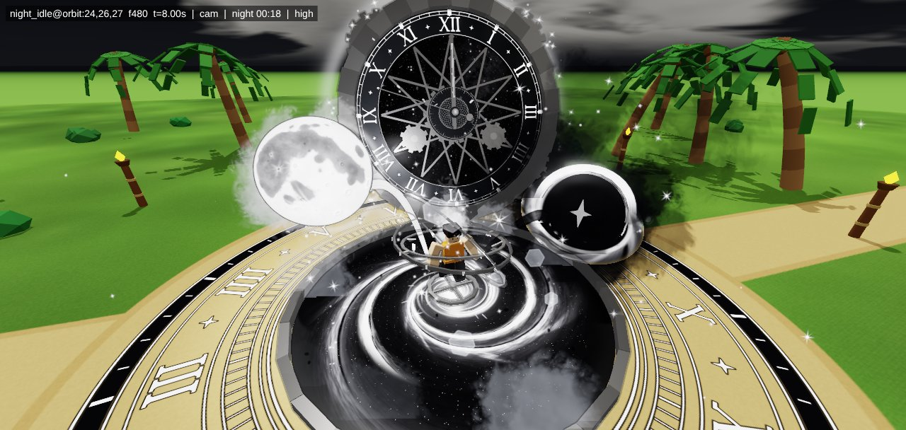
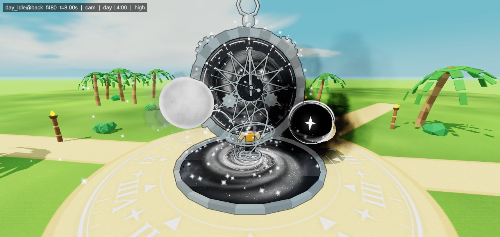
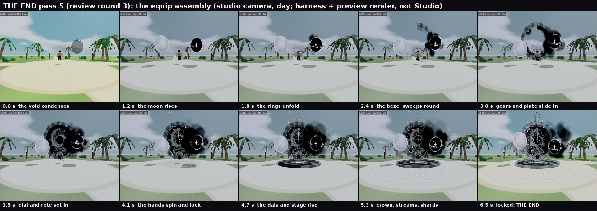
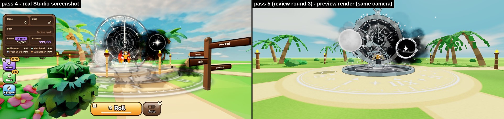

# THE END, pass 5: "The Last Clock"

This is the new **equipped** aura for 『 THE END 』 (1 in 1,000,000,000), the one you wear after you roll it. The roll
cutscene is not changed.

## What it is

A huge black-and-silver pocket watch, about 28 studs across, stands behind you and always turns to face whoever is looking.
Its hands are locked at XII (midnight, the end) while the seconds hand sweeps on. It keeps the clock, like you asked. On
one side is a solid cratered moon. On the other is a black void with a white star for a heart, and black ink smoke pouring
off it. Silver rings spin round your body. You float over a galaxy pool, and a 56-stud engraved clock stage lies on the
ground around it. Smoke, silver sparks, four-point sparkles, floor twinkles and ash give it depth. When you equip it, the
watch builds itself piece by piece in about 6.5 seconds.

It uses only black, white and silver. Everything is solid, not see-through, and there are no flashes or flicker. It's made
to read on the bright cyan day sky and at night, and to follow your character when you walk, jump, fly, glide and sit.

## Pictures

These come from our **cloud preview tool**, not from Roblox. Roblox's lighting and glow will make it look a bit different.
Pictures 1-3 show the new textures, which still need uploading. Until they are uploaded, the aura uses pass 4's textures
(picture 4).

**1. Day, from the camera you used for your pass-4 screenshots**

**2. Night, from the front corner**

**3. Close-up at night: the dial and star, the moon, the void and the galaxy pool**

**4. What you see while playing (camera behind you), with the pass-4 textures it starts with**

**5. Equipping it: the watch builds itself and locks at XII**

**6. Left: pass 4 in real Studio. Right: pass 5 in the preview, from the same camera**

All 14 pictures are in [`pass5-renders/`](pass5-renders/). What each one shows is listed under "Render set" in
[`pass5-build-notes.md`](pass5-build-notes.md).

## Where it stands (honest)

- **It's built, and it has been tested in the cloud only.** The cloud can't open Roblox Studio. So the code ran against a
  pretend version of Roblox in 35 test situations: day, night, flying, jumping, sitting, six players, respawning and more.
  It had no errors. The preview tool drew the pictures above from those tests.
- **Nothing has run in real Roblox yet.** The first real test is on your Mac. Some things can only be checked there, like
  how the glow looks, which way some textures face, and how fast it runs on your computer.
- Three rounds of reviews made it better. Each time, four "critics" looked hard at it, and then it was fixed.

## How to install it

Easiest way: open [`roblox/install/MILO_PROMPT.md`](../../roblox/install/MILO_PROMPT.md), copy the message in the box and paste
it into Claude Code on your Mac (with Studio open and the Studio MCP connected). It does the install, the tests and the
screenshots, and shows you everything.

The full steps, including doing it by hand, are in [`roblox/install/README.md`](../../roblox/install/README.md). Your current
pass-4 aura is backed up first, so nothing gets lost.

## What's still to do

1. **Install and test with the pass-4 textures first**, so we know the code runs in Studio.
2. **Upload the 18 new textures** (te5, moon first) from your Mac. See
   [`roblox/install/upload_textures.md`](../../roblox/install/upload_textures.md). Then install again.
3. **Check the STUDIO-VERIFY items.** There are 50 things only Studio can answer. The checklist is
   [`roblox/install/studio_checks.md`](../../roblox/install/studio_checks.md), and the full list is in the build notes.
4. **Your choices:**
   - the **far beacon** (a thin, steady spire over a wearer that only shows from far away: on or off);
   - **`FRAME_TOP`** (just the dial and XII in view, or the whole watch);
   - the silver: it's now neutral, a tiny bit warm, because the sunny sky tints metal cyan. Do you like it?
5. Then on to the other auras. You wanted *all* the VFX tenfold better.

## If something goes wrong: roll back

Run `roblox/install/payloads/99_rollback.luau` in Studio (Edit mode). It puts your pass-4 aura back exactly as it was, and
saves the pass-5 version first, so you can try again later. See step 5 of
[`roblox/install/README.md`](../../roblox/install/README.md).

## More detail

- [`pass5-spec.md`](pass5-spec.md): the full design (every part, size and number)
- [`pass5-build-notes.md`](pass5-build-notes.md): what was built, every review round, and the STUDIO-VERIFY list
- [`pass5-art-direction.md`](pass5-art-direction.md): the art director's "Last Clock" idea it all started from
- [`../../tools/README.md`](../../tools/README.md): the cloud test tools
