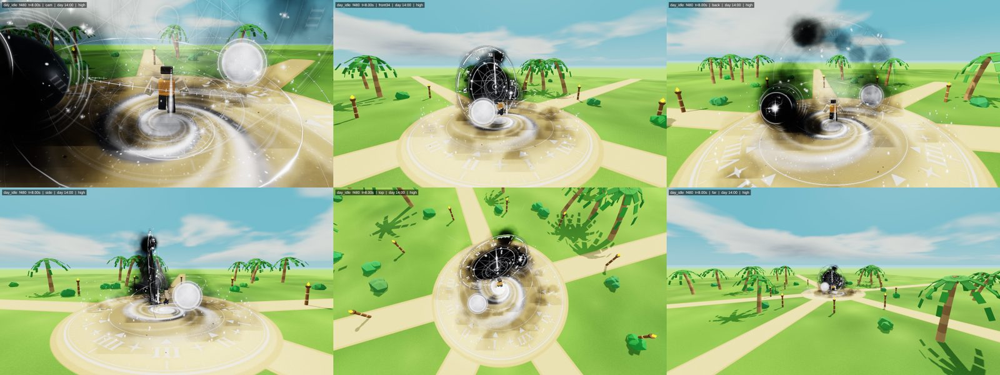

# Aura preview renderer

Turns harness snapshots (`tools/harness/SNAPSHOT.md`) into PNG renders that look as close as practical to Roblox Studio, so
people working in the cloud can **see** an aura without Studio. It is three.js (pinned `three@0.180.0`) running in headless
Chromium (Playwright `1.56.1`, WebGL through SwiftShader). The same renderer also powers `viewer.html`, an interactive page with an
orbit camera, day/night and a timeline.

It is calibrated against three real Studio screenshots of pass 4 from the 2026-10-14 Mac session (day, night, and the night
equip reveal), rendered from the same camera with the same orb positions: see `tools/baseline/pass4/compare_*.jpg` and
**[FIDELITY.md](FIDELITY.md)** for what to trust and what not to. Treat a render as a strong hint, not as proof: the real test
is still Play mode on Milo's Mac. For the one-command pipeline (harness + the standard renders) see `tools/README.md`.



## Quick start

```bash
cd tools/preview && npm install          # three, playwright (+ esbuild for the viewer build)
# Playwright's Chromium: this container has it in /opt/pw-browsers (PLAYWRIGHT_BROWSERS_PATH). Elsewhere: npx playwright install chromium

# render a harness run (every frame it captured), 6 views + a contact sheet per frame
python3 tools/harness/run_aura.py roblox/ReplicatedStorage/AuraFX/TheEnd.lua --out /tmp/run --snapshot "day_idle:t=3,8" --snapshot "night_idle:t=8"
node tools/preview/render.mjs --snapshot /tmp/run/snapshots --out /tmp/renders

npm --prefix tools/preview test           # smoke test: renders the fixtures and probes pixels (conventions)
npm --prefix tools/preview run fixtures   # rebuild + render every fixture into tools/preview/out/fixtures
npm --prefix tools/preview run viewer     # rebuild viewer.html from fixtures/pass4
```

A view takes about 1.5-3 s on 4 CPUs (SwiftShader). Output: `OUT/<scenario>_f<frame>_<view>.png` and
`OUT/<scenario>_f<frame>_sheet.png`. Warnings (unknown textures, placeholder meshes, effects the preview does not draw) are
printed per snapshot.

## Options

| option | default | |
|---|---|---|
| `--snapshot PATH` | (required) | a snapshot `.json`, or a folder (every `.json` under it). Repeatable. |
| `--views LIST` | `cam,front34,back,side,top,far` | comma list, see Views. |
| `--env auto\|day\|night` | `auto` | `auto` uses the snapshot's `clockTime` (day ~5.7-18.6 with dawn and dusk blends). |
| `--clock HOURS` | snapshot | override `Lighting.ClockTime`. |
| `--out DIR` | `tools/preview/out` | |
| `--size WxH` / `--size game` | `1280x720` | `game` = 1280 wide at the harness viewport's aspect (Studio's 1920x913). |
| `--ss 1\|2` | `1` | supersampling (renders at 2x and downsamples: crisper hairlines, 3-4x slower). |
| `--props on\|off` | `on` | palm trees, torch posts and bushes (never drawn between the camera and the wearer). |
| `--labels on\|off`, `--sheet on\|off`, `--bloom on\|off` | `on` | caption strip, contact sheet, the place's Bloom. |
| `--hide LIST` | | debug: hide `parts,guis,beams,trails,particles,lights,characters,env` (e.g. `--hide guis,beams` to see only particles). |
| `--tone filmic\|neutral` | `filmic` | tone curve: `filmic` (Narkowicz ACES fit, calibrated to Studio) or `neutral` (Khronos PBR Neutral, the first calibration). |
| `--aa on\|off` | `on` | `off`: no multisampling, as Roblox draws at low graphics levels and on phones (thin moving lines crawl in stair-steps). |
| `--sort centroid\|host` | `centroid` | the point a particle emitter is sorted at against other transparent objects: its particles' centre, or its host part (Roblox's rule is unverified; FIDELITY.md). |
| `--max-particles N` | `6000` | per emitter; above it 1 in k is drawn (warned). |
| `--tex5 DIR` / `--no-tex5` | `textures/te5` | where te5 manifests live (see Textures). |
| `--texmap FILE` | `texmap.json` | |

### Views

All presets are relative to the wearer: the body centre (`wearer.cf` + `hover`) and the way they face (`cf.LookVector`).
Field of view 70 (Roblox's default, vertical).

| view | camera |
|---|---|
| `cam` | the snapshot's own `Workspace.CurrentCamera` (CFrame + FieldOfView): what the player sees |
| `front` | 46 studs in front, 8° up | 
| `front34` | 45° off the front, 12° up, 48 studs |
| `back` | behind and above (36 studs, 14° up): the owner's usual game camera |
| `side` | from the wearer's right, 46 studs |
| `top` | 62° above, 56 studs |
| `far` | 130 studs (silhouette and LOD check) |
| `closeup` | 15 studs |
| `studio` | the camera of the real pass-4 Studio screenshots: Roblox's Custom camera with CameraSubject focus = HumanoidRootPart + 1.5 up, Zoom 40, looking from front x 38 + right x 8 + up x 1 |
| `orbit:AZ,EL,DIST[,TARGETY]` | any angle: azimuth from the front toward the right, elevation, distance (degrees, studs) |
| `subject:F,R,U,ZOOM` | Roblox's Custom camera in general (focus HRP + 1.5 up, ZOOM studs out along front x F + right x R + up x U) |

Views other than `cam` show the aura **as it was placed for the snapshot's camera**. Camera-facing things (BillboardGuis,
FaceCamera beams, particles) turn to the render camera, as Roblox does per client, but anything the module positions from the
camera (pass 5's viewer-anchored clock) stays where the module put it for `cam`. To see such a module properly from a preset,
run the harness with that camera (`run_aura.py --camera front34`, or a scenario named `day_idle@front34`; the harness reads
these presets from `web/views.js`) and render the `cam` view. `tools/check_aura.sh` does exactly that.

## Conventions implemented

Roblox and three.js are both right-handed, +Y up, cameras looking down -Z, so world coordinates are used as they are
(1 unit = 1 stud). `CF = [px, py, pz, r00..r22]` is `CFrame:GetComponents()`. Columns are RightVector, UpVector and -LookVector.

- **Parts.** Block. Ball: diameter = smallest Size component. **Cylinder: axis along local X** (length Size.X). **WedgePart**:
  rectangular bottom and back (+Z) faces, so the slope faces Front (-Z) and up. **CornerWedgePart**: apex above the (+X, +Z)
  corner, with vertical Right and Back faces. **Mesh** (MeshPart/union): the harness's fake film meshes
  (`rbxassetid://7000000000N`, or a name such as RingG, Dial, Astrolabe, Hand, Gear, Moon, SmoothSphere) get procedural stand-ins
  (ring, disc, openwork ring, pointer, toothed gear, sphere) laid along the mesh's thin axis from `meshSize`. Any other mesh is a
  translucent bounding box with an amber wireframe and a warning. SpecialMesh Sphere/Cylinder/Brick/Wedge are honoured.
  Decals are drawn as lit images over their face. `castShadow` is honoured (aura parts usually turn it off).
- **Materials.** Plastic (rough), SmoothPlastic (glossier), Metal (metalness 0.86, roughness 0.34, reflects the sky, so it turns
  cyan by day exactly as the Studio scout saw), Foil, Glass (translucent, clear-coated), **Neon** (unlit, colour x2.6 so white Neon
  crosses the bloom threshold, slightly more saturated), ForceField (additive fresnel shimmer). `Reflectance` raises metalness and
  gloss. `Transparency` combines with `LocalTransparencyModifier`. Transparent parts do not write depth and sort per object, as in Roblox.
- **SurfaceGui.** Faces in part space: Front = -Z, Back = +Z, Right = +X, Left = -X, Top = +Y, Bottom = -Y. The canvas lies on
  the face as seen from outside (Front: canvas right = -X; Back: +X; Right: -Z; Left: +Z). **Top: canvas up = +Z, right = -X**,
  the Front face folded back. **Bottom: canvas up = -Z.** Images use UDim2 size/position, AnchorPoint, Rotation (clockwise),
  ImageColor3, ImageTransparency, background frames and ZIndex order. They clip to the face and draw on one side only.
  Colour = image x ImageColor3 x (`LightInfluence` 0: `Brightness`; 1: the scene light), with two rules calibrated on the
  pass-4 captures (FIDELITY.md): **Brightness lifts the light texels only** (the dark ink edges of the lightdark textures stay
  dark, so the clock's black disc stays black), and **faint light texels count for less** (alpha^2.2 for light texels, as if
  GUIs blended in gamma space: soft glows do not grey out what is behind them). Brightness above 2 blooms. **A SurfaceGui
  hides what is behind its nearly opaque texels** (an invisible depth copy, alpha >= 0.6, drawn right after it), so particles,
  beams and billboards behind the clock's black disc do not show through, and a billboard crossing a solid GUI is cut.
  FixedSize uses `canvas`; PixelsPerStud uses `pixelsPerStud`. TextLabels are drawn TextScaled in a bold sans (no font in the snapshot).
- **BillboardGui.** Faces the camera plane, at the host (part or attachment) + `StudsOffset` in camera space (x right, y up,
  +z toward the camera) + `StudsOffsetWorldSpace`. Size in studs. MaxDistance and AlwaysOnTop are honoured. Pixel size offsets are ignored (warned).
- **Beam.** Cubic Bezier: P0 = a0, P1 = a0 + a0.X x CurveSize0, P2 = a1 - a1.X x CurveSize1, P3 = a1. `Segments` straight pieces,
  width lerps Width0 to Width1. FaceCamera turns the ribbon about its line toward the camera. Without FaceCamera the ribbon's
  normal follows the attachments' Y axes, so a beam between two default attachments lies flat, facing up. U runs from a0 to a1.
  **Stretch** repeats the texture `TextureLength` times over the whole beam. **Wrap/Static** repeat every `TextureLength`
  studs. `TextureSpeed` scrolls by `t`. Colour/Transparency sequences are sampled along the beam (refined to ~48 steps), and
  Brightness multiplies. **LightEmission 1 = additive, 0 = normal alpha, in between partly additive** (premultiplied blend
  `src*a + dst*(1 - a*(1-LE))`). Faint light texels count for less (alpha^2.2), as for GUIs: the pass-4 line textures read as
  thin lines in Studio, not glowing bands. Empty texture = solid.
- **ParticleEmitter.** This is a statistical re-simulation at `t`. Births sit on a lattice (`(k + jitter)/Rate`). Every random
  draw is a hash of (path, k), so renders are reproducible and particles keep their identity across frames. A particle is alive
  while `t - birth < lifetime`. With the harness's `hostHistory`, a particle is born only while the emitter was Enabled, at the
  host's CFrame at that moment (orbiting orbs leave real wakes, gliding wearers leave smoke behind). Without it the emitter is
  assumed to have run forever where it is now. `bursts` are added. Spawn: an attachment emits from a point; a part emits by
  Shape (Box, Sphere, Disc, Cylinder), ShapeStyle (Volume or Surface), ShapeInOut and ShapePartial (Disc: inner radius
  fraction; Cylinder: top radius fraction; Sphere: fraction of the polar angle). Disc and Cylinder align with
  EmissionDirection in the host's axes. Velocity is EmissionDirection (Sphere and Cylinder: radial) x Speed, turned by
  SpreadAngle. Then Acceleration (world) and Drag (speed halves every 1/Drag s). LockedToPart particles ride the host's
  current CFrame. Size, Transparency (with per-particle envelopes), Color and Squash are sampled at age/lifetime. Flipbooks
  (Grid2x2/4x4/8x8, frames row by row from the top-left) use OneShot, Loop (FlipbookFramerate), PingPong or Random.
  Rotation + RotSpeed, ZOffset (toward the camera, same screen size). Orientations: FacingCamera, FacingCameraWorldUp,
  VelocityParallel, VelocityPerpendicular. Particles sort back to front within an emitter. Brightness, LightEmission and
  LightInfluence follow the same rules as beams. TimeScale is honoured.
- **Trail.** Drawn from the harness's attachment `history` (positions every 0.1 s): one cross-section per sample, Lifetime cut,
  Color/Transparency/WidthScale over age, Stretch or Wrap texture. With no history a trail is skipped (warned).
- **Lights.** PointLight with a flat-then-smooth falloff to zero at Range (`Brightness x 2.4`). SpotLight and SurfaceLight are drawn as point lights (warned).
- **Highlight.** The adornee's parts (path prefix, or `adorneeId`) are rendered into a mask. For DepthMode Occluded the mask is
  depth-tested against everything opaque; AlwaysOnTop is not tested. FillColor is blended over the mask at 1 - FillTransparency,
  and an outline ring (~2 px at 720p) in OutlineColor at 1 - OutlineTransparency, with normal blending so ink outlines read on a
  bright sky. Roblox's cap of 31 Highlights is warned.
- **Effects.** ColorCorrectionEffects compound (Brightness, Contrast, Saturation, TintColor), like pass 4's wearer-only reveal
  grade. A BloomEffect made by the module replaces the place's Bloom. Blur, SunRays, DepthOfField, Atmosphere and Sky are not
  drawn (warned).
- **Characters.** The posed rig from the harness (`characters[]`: R15 or R6 parts with the floating pose applied) is drawn as
  rounded blocks with a face toward -Z. If it is missing, a plain R15 stand is built from `wearer` (body = HRP + hover, soles at -legLen).
- **`auraInWorld: false`** draws the world and the character only.

## The world around the aura

The world is the place as the captures show it: a plaza at y = 0 (or at `wearer.ground`) with sand paths through light-green
grass, palm trees, torch posts and bushes 50-150 studs out.

- **Day**: a cyan sky gradient (Studio's clear sky is ~(117, 189, 204), not deep blue) with domain-warped cumulus in a soft
  grey-white (~(200, 205, 202)). Sun from ClockTime: it rises at +X at 6:00, is highest at 12:00 (tilted 23.5° toward +Z) and
  sets at -X at 18:00. This is approximate, because the place's GeographicLatitude is not in the snapshot. Warm key light, a
  neutral OutdoorAmbient-style fill, sky image lighting, and soft shadows. The ground texture is 8 px per stud near the plaza.
- **Night**: a black sky with lit grey clouds (~(117-155) in the captures) and stars. Milo's place is **bright at night**:
  the ground keeps most of its colour (grass ~(98, 158, 41), sand stays light), so the night light is a neutral moon key plus
  a strong grey fill and only a slight desaturation.
- **Calibration** (sRGB; Studio = the real captures, preview = this renderer, `tools/preview/calibration_probe.py`): day grass
  (163, 220, 95) vs (157, 207, 94); day sand (243, 228, 185) vs (235, 226, 181); clear sky median (117, 189, 204) vs
  (117, 189, 204); night grass far from the aura (98, 158, 41) vs ~(101, 156, 51). Sky and fog colours in `web/env.js` are
  the colours Studio displays, pushed through the inverse tone curve. Light levels are per tone curve (`LIGHTS` in `env.js`).
- **Post**: an HDR buffer with 4x MSAA. Bloom matches the place's Lighting (Intensity 1, Size 24, Threshold 2): only the part
  of a pixel's brightest channel **above 2** blooms (so GUI Brightness 3.4, Neon and bright particles glow, sunlit white
  plastic does not), added back once (Intensity 1) with most of it within ~20 px at 1080p (`bloomWeights` in `post.js`).
  Then the **filmic tone curve** (Narkowicz ACES fit: with it, the day and night colours of sand, grass and leaves in the
  captures agree with a single ~0.45x night light; with a linear-toe curve they cannot), then sRGB.

## Textures

`texmap.json` maps asset ids to local PNGs; paths are relative to it.

1. **Real pass-4 textures** (`textures/te4/te4_*.png`, regenerated by `textures/te4/make_theend_tex4.py`, ids in
   `textures/te4/uploaded.md`). These are the actual images uploaded on 2026-10-13. The generator was reconstructed from the
   Mac transcript: the original heredoc, the orb edit, then the two appended blocks. The only difference is the numeral font
   (Liberation Serif instead of Times New Roman).
2. **Stand-ins** (`standins/*.png`, `python3 standins/make_standins.py`) for ids we only have on the Mac: the AuraCinema kit and VFX
   Studio (glow, glint, sparkles 4x4, puff 4x4, mist 4x4, swirl, ornate, swirlRing, pillar) and pass-1/2 `tex`/`tex3` (softGlow,
   rim, shards, flare, streak, galaxy, gring, void, spark, ash, sigil, hands). They match the role, shape, alpha and flipbook
   layout, not the exact look. `sparkles_main` stands in for Roblox's default particle texture.
3. **te5** (pass 5). Every `textures/te5/<group>/manifest.json` is read (`--tex5 DIR` to point elsewhere, `--no-tex5` to
   ignore). Entries carry `name`, `file`, `texKey` and optionally `id`/`assetId`. A texture string `pending:<texKey>` (or
   `te5:<name>`) maps to that file. A real id listed in a manifest maps too. A `pending:` key without a file falls back to its
   pass-4 TEX texture (the spec's FALLBACK table, in `texmap.json` `pendingFallback`), with a warning.
4. **Anything else** draws as a neutral soft grey dot, with a warning that names the id.

Fixture-only strings (`fixture:face_front`, ...) map to `fixtures/tex/`.

## Fixtures, tests and references

- `fixtures/make_fixtures.mjs` writes `all_elements{,_night,_graded}.json`. They contain every shape, film-mesh stand-in and
  material; a cube with a labelled SurfaceGui on all six faces (plus one turned 45°); a glowing Top-face galaxy; beams (a
  FaceCamera arc with Wrap arrows, a flat Stretch beam, an additive column); BillboardGuis (offset, AlwaysOnTop behind a
  wall); emitters of every shape (flipbooks, VelocityParallel, LockedToPart, drag, acceleration); a PointLight; a Highlight;
  a Trail with history; and a ColorCorrection. Arrows on the textures point to the image top and along +U, so the
  conventions are visible.
- `fixtures/pass4/` holds real harness frames of the live pass-4 module (`day_idle` during the equip assembly at t = 1, 2, 3,
  4, 6, 8 s and `night_idle` at 8 s). Numbers are trimmed to 6 significant digits.
- `fixtures/reference/*.jpg` are the contact sheets these produce. Compare after changing the renderer.
- `npm test` (`test/smoke.mjs`) renders the fixtures and probes pixels: the Front label faces -Z, the Back label faces +Z, the
  Top label is green from above, white Neon glows, black Neon stays dark, the night sky is dark, unlit GUIs keep their colour
  at night, and ColorCorrection desaturates.

## viewer.html

`viewer.html` is one self-contained page, about 4 MB. It embeds `fixtures/pass4` and its textures (downscaled to 512 px) and
bundles this renderer (esbuild). three.js loads from `https://cdn.jsdelivr.net/npm/three@0.180.0/`. It is a page fragment, ready
to publish as an artifact; add `--standalone` for a full HTML document. It has an orbit camera, the view presets, day/night,
and a timeline over the snapshots with Play. You can drop more snapshot JSON files onto it (their unknown textures draw as
dots). Rebuild it from any harness run:

```bash
node tools/preview/build-viewer.mjs --snapshot /tmp/run/snapshots --out /tmp/viewer.html [--title "THE END Aura Viewer"] [--max-tex 512] [--start N]
```

## Known fidelity gaps

The full list, with the evidence, is **[FIDELITY.md](FIDELITY.md)**. In short:

- **Stand-in textures** for kit, VFX Studio and tex3 ids. Shapes and alpha are plausible and several were tuned to the pass-4
  captures (the tex3 void is a dense black smoke disc, the ground ring has big numerals, the kit smoke is fuller, the spinning
  swirl ring and the shards are faint), but the real images differ. The te4 textures are real.
- **No real meshes.** Film meshes are procedural stand-ins and other MeshParts are boxes. MeshPart TextureIDs and
  SurfaceAppearance are not drawn (no UVs).
- **Unverified conventions, from memory of Roblox:** the Top/Bottom SurfaceGui canvas orientation, the WedgePart slope
  facing Front (-Z), CornerWedge's apex corner,
  the orientation of beams without FaceCamera, Beam Stretch vs TextureLength, and the exact ShapePartial and Squash maths.
  The fixtures make each one visible; check one in Studio when a build depends on it.
- **Particles** are steady-state when there is no history. Emitters enabled moments ago look already full. Velocity
  inheritance is ignored. LockedToPart particles use the current host frame for their whole life. FlipbookFramerate defaults
  to 1 if missing.
- **No soft particles, as in Roblox.** Big smoke billboards that cross the ground show straight cut lines (visible under
  pass 4's ground smoke). This is believed to match Studio, but it was not confirmed.
- **Roblox GUI depth quirks** are only approximated: here a SurfaceGui hides what is behind its nearly opaque texels; in
  Studio a billboard behind the pass-4 dial planes reads faint (the moon in capture 032409) and a translucent ring plane cut
  the moon's sprite (the "white wedge"), which this does not reproduce.
- **Lighting is approximate.** Roblox's exact tone curve, bloom kernel, shadow softness, Atmosphere haze, Neon colour shift,
  Plastic grain, light falloff, Glass refraction and Future-lighting specular all differ in detail. Graphics-quality levels
  (fewer particles on phones) are not simulated; the harness's `quality: "low"` builds are rendered as built.
- The sun direction depends on GeographicLatitude, which is not recorded, so shadows may point a different way than in Studio.

## Files

```
render.mjs            CLI (headless renders)            build-viewer.mjs   viewer.html builder
lib/textures.mjs      texture resolution (texmap, te5)  lib/browser.mjs    Chromium + file routing
web/preview.js        snapshot -> scene, render a view  web/env.js         sky, ground, props, sun/moon
web/parts.js          parts, materials, film meshes      web/guis.js        SurfaceGui, BillboardGui, decals, text
web/ribbons.js        beams, trails                     web/particles.js   particle re-simulation
web/post.js           bloom, tone map, Highlight, CC    web/views.js       camera presets
web/page.html         headless page                     web/viewer-app.js + viewer.template.html   the viewer
sheet.py              contact sheets, Studio | preview  calibration_probe.py  colour probes vs a real capture
FIDELITY.md           what to trust                     texmap.json        asset ids -> PNGs
standins/             procedural stand-ins + generator
fixtures/             fixture generators, snapshots, real pass-4 frames, reference sheets
test/smoke.mjs        pixel-probe smoke test
```
